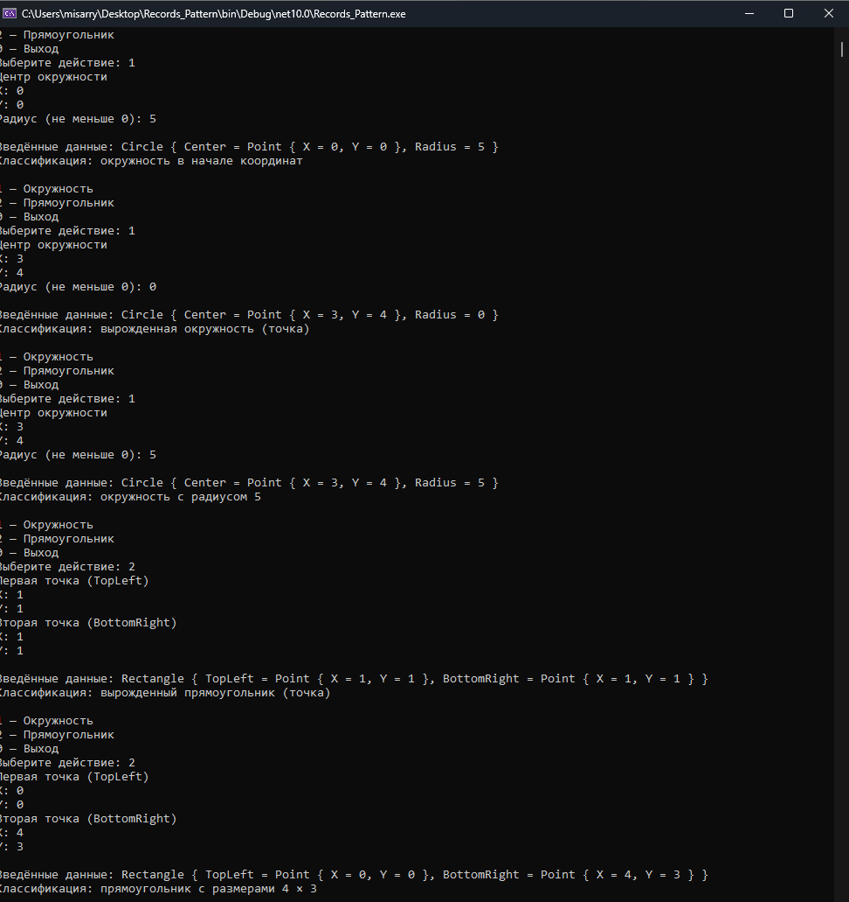

# КТ №16 — Records и паттерн-матчинг

Вариант 1: **«Геометрические фигуры через записи»**. Консольный проект C# для Visual Studio 2026 и .NET 10. Пользователь создаёт фигуры, видит введённые данные и результат классификации.

## Структура проекта

- `KT16.sln` — решение для Visual Studio.
- `KT16.csproj` — консольный проект, целевая платформа `net10.0`.
- `Point.cs` — запись точки с координатами `X`, `Y`.
- `Circle.cs` — запись окружности с центром `Center` и радиусом `Radius`.
- `Rectangle.cs` — запись прямоугольника с точками `TopLeft`, `BottomRight`.
- `ShapeClassifier.cs` — метод `string Classify(object shape)` со switch expression.
- `Program.cs` — меню, ввод и проверка чисел, показ результата.
- `README.md` — этот файл («читай»).

## Запуск

Распакуйте ZIP обычными средствами Windows. Откройте `KT16.sln` в Visual Studio 2026 с установленной поддержкой .NET 10 и нажмите **Ctrl+F5**.

Из терминала в папке проекта:

```text
dotnet build KT16.sln
dotnet run --project KT16.csproj
```

## Что вводит пользователь

Выберите `1` для окружности, `2` для прямоугольника или `0` для выхода. Для окружности введите X и Y центра, затем неотрицательный радиус. Для прямоугольника введите X и Y каждой из двух противоположных вершин. Ширина и высота вычисляются как абсолютные разности координат; точки можно вводить в любом порядке.

Допускаются отрицательные координаты, дробные числа с точкой или запятой. Неверный ввод, отрицательный радиус, NaN и бесконечность отклоняются с повторным запросом. После результата снова появляется меню, поэтому можно ввести несколько фигур за один запуск.

## Примеры одного запуска

```text
Выберите действие: 1
Центр окружности
X: 0
Y: 0
Радиус (не меньше 0): 5
Введённые данные: Circle { Center = Point { X = 0, Y = 0 }, Radius = 5 }
Классификация: окружность в начале координат

Выберите действие: 1
Центр окружности
X: 2
Y: 3
Радиус (не меньше 0): 0
Введённые данные: Circle { Center = Point { X = 2, Y = 3 }, Radius = 0 }
Классификация: вырожденная окружность (точка)

Выберите действие: 2
Первая точка (TopLeft)
X: 1
Y: 5
Вторая точка (BottomRight)
X: 4
Y: 1
Введённые данные: Rectangle { TopLeft = Point { X = 1, Y = 5 }, BottomRight = Point { X = 4, Y = 1 } }
Классификация: прямоугольник с размерами 3 × 4

Выберите действие: 0
Программа завершена.
```

## Records и паттерны

Позиционные `record` создают свойства с `init`, сравнение по значениям и удобный `ToString()`. После создания свойства нельзя переназначить обычным присваиванием. Две отдельно созданные точки с одинаковыми координатами равны, поэтому `r.TopLeft == r.BottomRight` проверяет совпадение значений точек.

Классификатор использует switch expression с ветками строго в следующем порядке:

1. `Circle { Center: { X: 0, Y: 0 } }` — вложенный property pattern: проверяет координаты записи Point внутри свойства Center окружности.
2. `Circle { Radius: 0 }` — property pattern для нулевого радиуса.
3. `Circle c` — type pattern: любая оставшаяся окружность, строка с её радиусом.
4. `Rectangle r when r.TopLeft == r.BottomRight` — type pattern и дополнительное условие `when`: совпадающие вершины дают точку.
5. `Rectangle r` — любой оставшийся прямоугольник, строка с шириной и высотой.
6. `_` — неизвестная фигура для других объектов (например, строки или Point).

Выбирается первая подходящая ветка. Окружность с центром (0, 0) и радиусом 0 получает результат «окружность в начале координат», потому что вложенная проверка стоит раньше проверки радиуса. Общие ветки Circle и Rectangle расположены после специальных случаев. По заданию прямоугольник с одной нулевой стороной и разными вершинами попадает в обычную ветку размеров. Меню создаёт только Circle и Rectangle; резервная ветка доступна при прямом вызове классификатора.

## Скриншот работы программы


